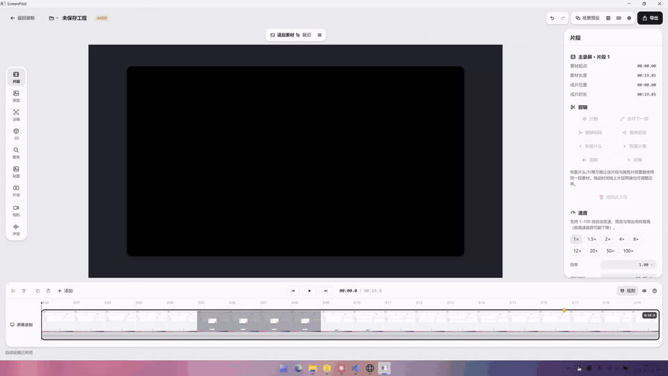

# ScreenPilot

一个自用的 Windows 录屏和轻量剪辑工具，用来录软件演示和操作讲解：录下屏幕和声音，剪一剪，加上运镜、背景和光标效果，导出成片。

使用 C++20 和 Qt 6.8（Qt Quick）开发。这是个人项目，按我自己的使用需要开发，只在我自己的机器上测试过，不保证兼容其他环境，也不保证长期维护。

## 演示

录制时屏幕上只有一条小浮条：


编辑器：自动运镜、背景与样机、剪辑、导出：



## 功能

**录制**
- 录制整个屏幕、单个窗口或屏幕上的一块区域
- 同时录系统声音（全部或指定应用）和麦克风，分别保存为独立音轨
- 可选同步录制摄像头
- 录制时只显示一条置顶的小浮条：计时、暂停/继续、加标记、备忘录、重新录制/丢弃、停止；浮条本身不会被录进视频
- 原始分辨率、最高 4K 或最高 1080p；30/60 FPS；H.264 或 HEVC
- 同时记录鼠标轨迹和点击，供后期的光标效果和自动运镜使用

**剪辑**
- 时间线：分割、修剪、删除、重排、变速（1–100 倍，保持音调）、吸附、撤销/重做
- 缩略图和波形、录制标记跳转、快捷键
- 自动运镜（根据点击位置放大跟随）和手动运镜片段，多种过渡曲线
- 屏幕 3D 角度、模糊/聚光区域、贴图、开场动画
- 摄像头画中画：布局、形状、大小、同步偏移和同步点

**画面**
- 画布比例、裁切、留白、圆角、阴影
- 纯色、图片或循环视频背景；窗口、浏览器、设备样机外框
- 光标样式和点击反馈
- 场景预设：保存、套用一整套画面设置

**导出**
- MP4（带声音或静音）、仅音频 M4A
- 原始分辨率、1080p、1440p、4K；30/60 FPS
- 支持导出选区、显示进度、可取消；也可以直接导出原始素材

**工程**
- 工程保存为 `.spproj` 文件夹（内含 `project.json` 和素材），可以重新打开继续编辑
- 最近工程列表、编辑中自动保存恢复点

## 运行环境

- Windows 11 x64（Windows 10 2004 及以上应该也能用，但没有测试过）
- 录制浮条和备忘录"不被录进视频"依赖 Windows 10 2004 引入的窗口捕获排除

## 构建

需要：

- Qt 6.8（MSVC 2022 64-bit 版本，包含 Qt Multimedia）
- Visual Studio 2022 或更新版本（MSVC，C++20）
- CMake 3.24+ 和 Ninja

```powershell
.\scripts\build-windows.ps1 -QtRoot 'C:\Qt\6.8.3\msvc2022_64' -Deploy
```

构建完成后，双击 `启动 ScreenPilot.cmd`，或直接运行 `build\desktop\portable\ScreenPilot.exe`。更多说明（目录结构、测试程序、性能基准）见 [docs/building.md](docs/building.md)。

## 性能现状

**性能目前只是"能用"，离流畅还有很大差距，优化空间非常大。**

- **合成全在 CPU 上**：解码帧转换和画面合成都是 CPU + QPainter，没有使用 GPU。1440p 预览 1 倍速勉强接近 60 FPS，4 倍速只有约 35 FPS，4K 预览会明显卡顿
- **导出慢**：使用 Qt 自带的软件 H.264 编码，没有用显卡硬件编码（NVENC/AMF/QSV）；几分钟的 1080p/1440p 视频，导出耗时约为片长的 1–2 倍
- **解码走软件**：为配合 CPU 合成关掉了硬件解码；导出的取帧也依赖播放器回放，而不是直接解码
- **录制时部分工作在界面线程**：帧调度、鼠标采样（约 30 Hz 轮询，极快的点击可能漏掉）和音频采集都由界面线程驱动，界面卡顿时可能影响录制
- **工程数据结构粗糙**：工程模型大量使用通用的 QVariant 容器，任何一处改动都会让整个界面重新计算，工程变复杂后编辑会变慢

已经做过的优化和实测数据见 [CHANGELOG.md](CHANGELOG.md)。计划中的方向：GPU 合成与硬件编解码、录制和音频改用独立线程、鼠标改用系统钩子、工程模型改用强类型数据。

## 其他已知限制

- 系统鼠标会被直接录进视频，打开光标美化时画面里会同时出现系统鼠标和美化后的光标
- 只有中文界面（设置里的语言选项暂不生效）
- 没有安装程序；更新功能只检查并打开发布页
- 摄像头相关功能没有在真实摄像头上测试过

## 以后可能加入

- AI 字幕：根据录制的声音自动生成字幕
- AI 剪辑：自动剪掉停顿和无效片段、推荐运镜

这些还只是想法，没有排期。

## 目录结构

```
app/        程序代码和 QML 界面（编译为 screenpilot_core 静态库）
tests/      冒烟测试、性能探针和基准，编译为 ScreenPilotProbe.exe（不随程序发布）
scripts/    构建脚本
docs/       构建与测试说明
third_party/ 第三方许可声明
```

更新记录见 [CHANGELOG.md](CHANGELOG.md)，界面设计规范见 [DESIGN.md](DESIGN.md)。

## 许可

本项目以 [MIT 许可证](LICENSE) 发布。
